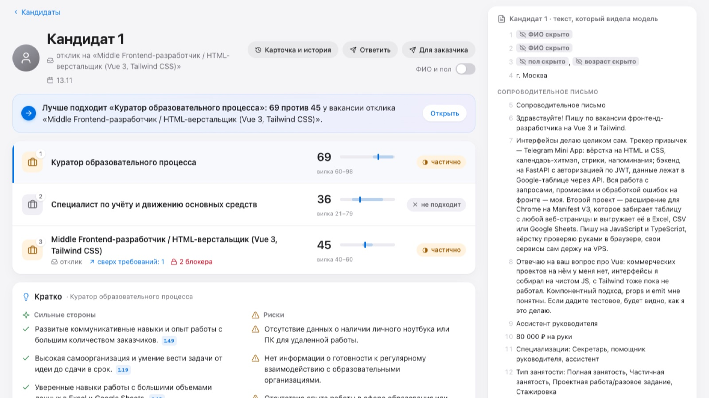
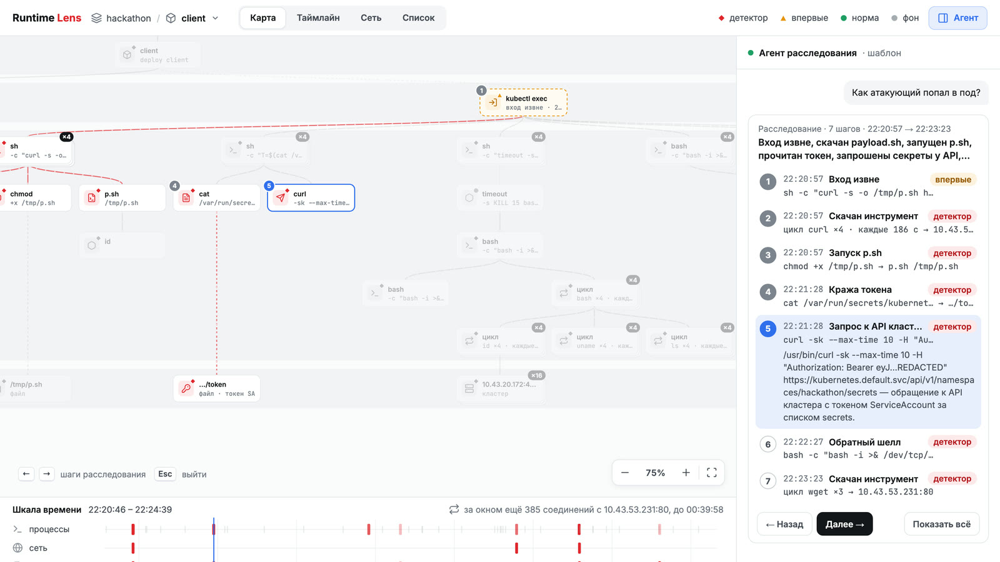
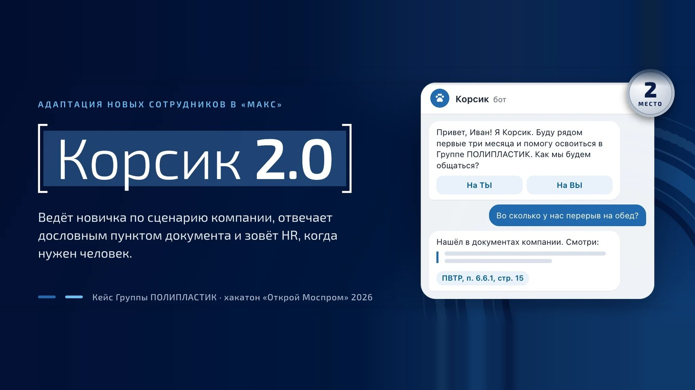
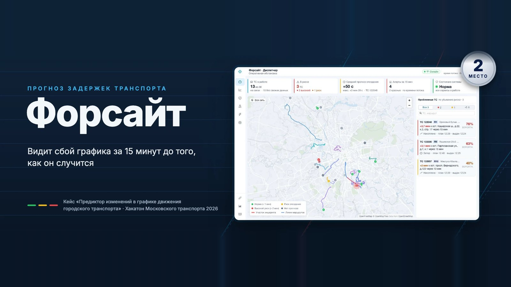
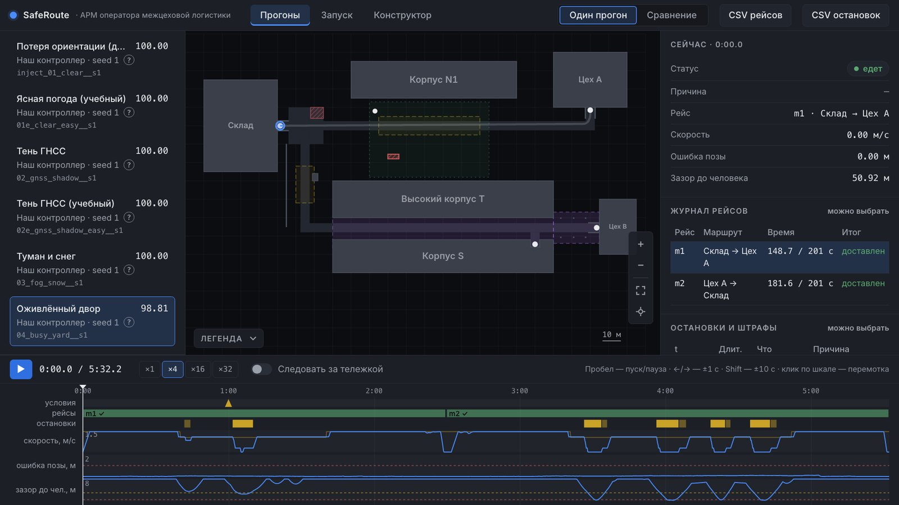
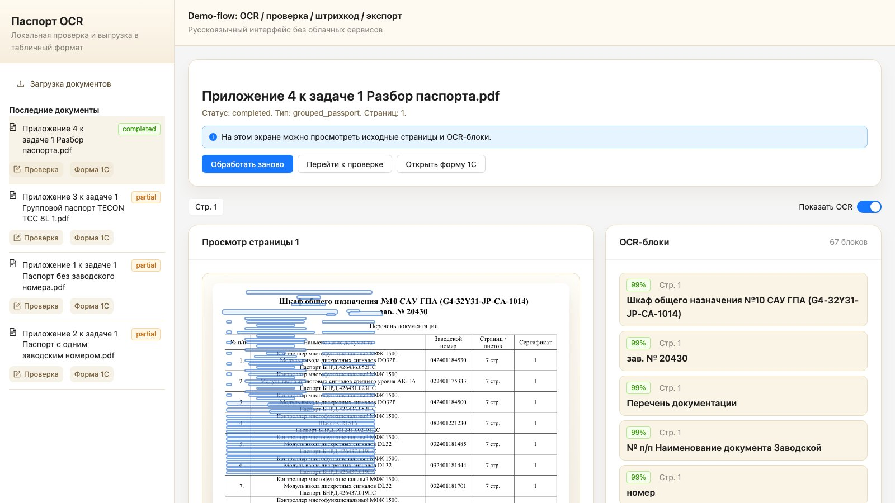

<h1 align="center">Иван Суслов</h1>

  AI Engineer &nbsp;·&nbsp; LLM-агенты &nbsp;·&nbsp; DevOps &nbsp;·&nbsp; Москва

  
  
  

### Обо мне

Строю LLM-агентов и инфраструктуру под них: от self-hosted моделей на своём GPU до production-агента с RAG.
Пишу на Python и Go, сервисы запускаю в Docker, мониторинг веду в Prometheus и Grafana.

<table>
  <tr><td width="230"><b>Фокус</b></td><td>LLM-агенты, RAG, self-hosted модели, инфраструктура под них</td></tr>
  <tr><td width="230"><b>Бэкграунд</b></td><td>Backend на Python и Go, DevOps, мониторинг</td></tr>
  <tr><td width="230"><b>Образование</b></td><td>МАДИ — «Информатика и вычислительная техника», 2 курс, заочно</td></tr>
  <tr><td width="230"><b>Формат работы</b></td><td>Москва, гибрид или удалённо</td></tr>
</table>

### Хакатоны

<table>
  <tr>
    <td width="50%" valign="top">
      
      <h4>Хакатон «ИИ в управлении МФТИ» 2026</h4>
      
🏆 <b>3 место</b> &nbsp;·&nbsp; 15 ноября 2026

      
«Сверка»: примерно за 40 секунд сопоставляет резюме со всеми открытыми вакансиями МФТИ. Ранжирует вакансии, проверяет каждое требование по дословной цитате из резюме и отмечает кандидатов, которые откликнулись не на ту вакансию. Персональные данные маскируются до передачи модели; модель только читает, оценку считает код. Плюс рабочее место рекрутера: отклики из почты и hh.ru, пакет DOCX для нанимающего менеджера.

      
<a href="https://github.com/Kurligin/resume-vacancy-match">Код</a> &nbsp;·&nbsp; <a href="https://mipt-hac.rapira-cloud.ru">Демо</a>

    </td>
    <td width="50%" valign="top">
      
      <h4>«Ночь кода» 2026</h4>
      
🏆 <b>Победа в кейсе Positive Technologies</b> &nbsp;·&nbsp; <b>3 место</b> в общем зачёте &nbsp;·&nbsp; 8 ноября 2026

      
Runtime Lens: интерактивная карта активности контейнера Kubernetes на событиях Runtime Radar (Tetragon, eBPF). Превращает 20 тыс. сырых событий в карту процессов, таймлайн и сетевую картину, собирает шаги атаки от <code>kubectl exec</code> до reverse shell и сопоставляет их с MITRE ATT&amp;CK. Ядро анализа — отдельный сервис на Python. Сделано за одну ночь.

      
<a href="https://github.com/Kurligin/runtime-lens">Код</a> &nbsp;·&nbsp; <a href="https://mos.hub.rapira-cloud.ru">Демо</a>

    </td>
  </tr>
  <tr>
    <td width="50%" valign="top">
      
      <h4>«Открой#Моспром» 2026</h4>
      
🏆 <b>2 место</b> &nbsp;·&nbsp; 25 октября 2026

      
Ассистент по онбордингу новых сотрудников группы «Полипластик» в мессенджере MAX. Отвечает точными цитатами из документов компании и указывает источник. Всё, чего нет в документах, передаёт в HR.

      
<a href="https://github.com/Kurligin/mosprom-polyplast">Код</a> &nbsp;·&nbsp; <a href="https://mosprom-polyplast.rapira-cloud.ru">Демо</a>

    </td>
    <td width="50%" valign="top">
      
      <h4>Хакатон Московского транспорта 2026</h4>
      
🏆 <b>2 место</b> &nbsp;·&nbsp; 3 октября 2026

      
Foresight: по живой телеметрии транспорта за 10–15 минут прогнозирует задержки на остановках, объясняет вероятную причину и поднимает алерты на дашборде диспетчера. Каждый прогноз потом сверяется с фактическим прибытием. Моя часть: ML-модель на CatBoost и backend на FastAPI.

      
<a href="https://github.com/DverkuOff/foresight">Код</a> &nbsp;·&nbsp; <a href="https://dverkuoff.github.io/foresight/">Документация</a>

    </td>
  </tr>
  <tr>
    <td width="50%" valign="top">
      
      <h4>КосмоХакатон 2026 · финал</h4>
      
🏆 <b>2 место</b> &nbsp;·&nbsp; 27 сентября 2026

      
SafeRoute: контроллер автономной платформы доставки, которая возит грузы между складом, магазинами и зарядкой без GNSS, в туман и снег, объезжая людей. В комплекте АРМ оператора для воспроизведения и сравнения заездов. Моя часть: фильтр Калмана для навигации без GPS. До финала — 2 место на окружных этапах в Нижнем Новгороде и Красноярске.

    </td>
    <td width="50%" valign="top">
      
      <h4>Хакатон по ИИ-автоматизации 2026</h4>
      
🏆 <b>3 место</b> &nbsp;·&nbsp; 25 апреля 2026

      
«Газпром автоматизация» × РТУ МИРЭА. Локальная оцифровка паспортов оборудования: OCR, классификация типа документа, извлечение полей, выгрузка в JSON, CSV и XLSX.

      
<a href="https://github.com/Kurligin/mirea-hac">Код</a>

    </td>
  </tr>
</table>

### AI и backend

<table>
  <tr><td width="230"><b>LLM и агенты</b></td><td>LLM-агенты, RAG, MCP, n8n, Langfuse</td></tr>
  <tr><td width="230"><b>Модели</b></td><td>OpenAI API, llama.cpp, Whisper</td></tr>
  <tr><td width="230"><b>Python</b></td><td>FastAPI, aiogram, SQLAlchemy, pytest</td></tr>
  <tr><td width="230"><b>Go</b></td><td>Gin, REST, gRPC</td></tr>
  <tr><td width="230"><b>Данные и очереди</b></td><td>PostgreSQL, pgvector, Redis, RabbitMQ, MongoDB</td></tr>
</table>

### DevOps

<table>
  <tr><td width="230"><b>Контейнеры</b></td><td>Docker, Docker Compose</td></tr>
  <tr><td width="230"><b>CI/CD</b></td><td>GitHub Actions</td></tr>
  <tr><td width="230"><b>IaC и автоматизация</b></td><td>Terraform, Ansible, Bash</td></tr>
  <tr><td width="230"><b>Мониторинг</b></td><td>Prometheus, Grafana, Alertmanager, node_exporter, Loki, Fluentd</td></tr>
  <tr><td width="230"><b>Сеть</b></td><td>Linux, Nginx, Traefik, WireGuard</td></tr>
</table>

Базово знаком с Kubernetes (однонодовый стенд на kubeadm), Helm, Docker Swarm, LangGraph и Qdrant.
